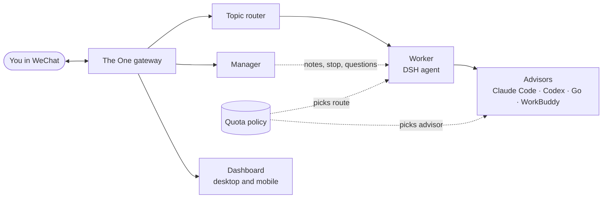

<p align="center">
  
</p>

<h1 align="center">The One</h1>

<p align="center">
  <b>One chat. A whole AI team behind it.</b><br>
  Talk to your agents in WeChat the way you'd talk to a colleague. The One keeps your projects apart,<br>
  remembers where each one left off, and spends your AI subscriptions where there's room.
</p>

<p align="center">
  <a href="https://github.com/YunongDai2005/theone-agent/actions/workflows/test.yml"></a>
  <a href="LICENSE"></a>
  <a href="package.json"></a>
  
</p>

<p align="center">
  <b>English</b> · <a href="README.zh-CN.md">简体中文</a>
  &nbsp;·&nbsp; <a href="https://YunongDai2005.github.io/theone-agent/demo/">Interactive demo</a>
  &nbsp;·&nbsp; <a href="#try-it-in-one-minute">Try it</a>
  &nbsp;·&nbsp; <a href="docs/DEPLOY.md">Deploy</a>
</p>

---

## Why

You already pay for several AI tools. Using them is still a job:

- **You decide which chat a question belongs to.** The One reads each message and drops it into the right project, picking up that project's own session and memory.
- **The agent goes quiet for twenty minutes.** A Manager answers you straight away, passes along changes, and stops the work the moment you say stop.
- **You juggle 5-hour, weekly, and monthly limits.** Work goes to whichever subscription still has room, and to the one about to reset first.

## What it does

| | |
| --- | --- |
| **Talk while it works** | While the worker is busy, the Manager answers status questions, files your additions, and interrupts only when a new instruction conflicts with what's running. |
| **Never pick a session** | Each message is routed to its topic automatically. Return to yesterday's project and its context comes back. Say "切错了" ("wrong topic") to undo a switch. |
| **Never lose context** | When a session fills up, a new day starts, or you've been away for hours, the old session writes a handoff and the new one picks it up. |
| **Spend quota wisely** | One quota policy across Go, ChatGPT, Claude Code, and WorkBuddy: safety reserves, in-flight reservations, near-reset first, and a fallback when a route fails. |
| **See it at a glance** | A dashboard for desktop and phone: what the worker is doing now, what needs you, today's numbers, quota with reset countdowns. |
| **Improves itself, with your OK** | Each night it reviews the previous day. It tunes a few parameters within fixed limits and writes improvement proposals that only ship after you approve them in chat. |

## See it

<p align="center">
  <a href="https://YunongDai2005.github.io/theone-agent/demo/"></a>
</p>

<p align="center"><a href="https://YunongDai2005.github.io/theone-agent/demo/"><b>Open the interactive replay →</b></a><br>
<sub>Seven messages across a website, battery research, and a Python tool, with no session switching. Routing and session code are real; messages, model decisions, and the worker are fixtures.</sub></p>

<table>
  <tr>
    <td align="center"><br><sub>Home: the task in progress and what needs you</sub></td>
    <td align="center"><br><sub>Memory: topics, handoffs, knowledge</sub></td>
    <td align="center"><br><sub>Evolve: nightly review and proposals</sub></td>
  </tr>
</table>

## Try it in one minute

No WeChat account, API keys, or `npm install` needed. Node.js 22+ is enough.

```bash
git clone https://github.com/YunongDai2005/theone-agent.git
cd theone-agent

npm test                        # 70+ replay scenarios and unit tests against fake services
node test/dev-dashboard.mjs     # live dashboard with sample data → http://127.0.0.1:8933/
npm run demo:record             # rebuild the replay → open docs/demo/index.html
```

Everything runs on loopback in temporary directories. Nothing touches a real account.

## Talk to it

Plain sentences are fine. These commands give you direct control:

| Send | What happens |
| --- | --- |
| *anything* | Goes to the right topic and the worker starts on it |
| `停` | Stops the current task immediately (typed or by voice) |
| `/进度` | What the worker is doing right now |
| `/new` | Start a new topic. Old ones are kept and resume when you return to them |
| `切错了` | The last message went to the wrong topic: undo and answer it in the right one |
| `/话题` | List your topics |
| `/经理` | Manager status, unread notes, open questions from the worker |
| `/回答 N …` · `/通过 N` · `/拒绝 N` | Answer the worker's question or approve/deny a tool action |
| `/进化` | Last night's review and proposals |
| `/批准 N` · `/上线 N` · `/否决 N` | Approve a proposal for implementation, ship it, or drop it |
| `/看板 <what you want to see>` | Ask the worker to add a dashboard card |
| `/帮助` | Every command |

## How it works



The gateway sits between WeChat (via Tencent iLink and the OpenClaw WeChat plugin) and a DSH (DeepSeek Harness) command-line agent on a Linux machine. Every feature is a plugin: topics, Manager, handoffs, progress, quota, dashboard cards, self-review. Each plugin attaches to a small set of hooks, so features can be turned off one at a time and new ones can bring their own dashboard cards. See [architecture](docs/ARCHITECTURE.md) and [design](docs/DESIGN.md).

## Run it for real

You need a Linux machine, the DSH agent CLI, the OpenClaw WeChat plugin with a bot account, and at least one model subscription or API key.

1. Copy `config.example.json` to `config.json` and point it at your plugin, account file, and worker.
2. Route the OpenClaw WeChat channel through the gateway at `http://127.0.0.1:8787`.
3. Run `npm start` and check `http://127.0.0.1:8788/api/v2/status`.
4. Serve `web/index.html` and proxy `/api/v2/*` to the gateway to get the dashboard.

The full guide, including credentials, optional plugins, and privacy notes, is in **[docs/DEPLOY.md](docs/DEPLOY.md)**.

## Status

The One is experimental. One person built it and runs it every day on a single home server.

- **Serial per chat.** Topics keep separate sessions, but one chat runs one task at a time.
- **Restart-safe only in part.** Worker runs are cleaned up after a restart, but queued tasks live in memory.
- **Model judgment can be wrong.** Topic routing and the Manager's decisions use models. The tests check how decisions are handled, not how accurate the models are.

Next up: a dedicated session administrator, durable task scheduling, and bounded parallel work across unrelated topics. See the [roadmap](docs/DESIGN.md#roadmap).

## Contributing

The most useful help is on **conversation routing, session memory, interruption handling, and reliable scheduling**.

- Routing bug? Open an issue with a short synthetic or redacted conversation, the topic you expected, and what happened.
- Code? Read the [architecture](docs/ARCHITECTURE.md), prefer a plugin, add a replay scenario, and run `npm test`.
- Detailed docs are in Chinese. English translations are welcome.

If this is a system you'd use, **star the repo** and tell us in [Issues](https://github.com/YunongDai2005/theone-agent/issues) which conversations it should handle.

## License

[MIT](LICENSE). Frameworks, plugins, CLIs, and model services keep their own licenses and terms; none of their code, weights, or credentials are included. Formerly published as *AI Box Gateway*.
