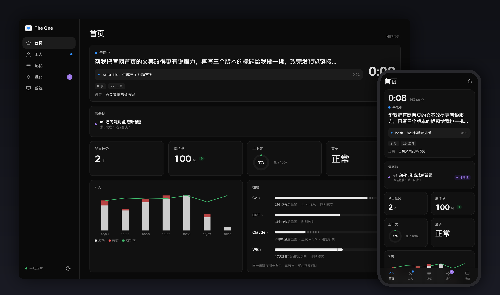
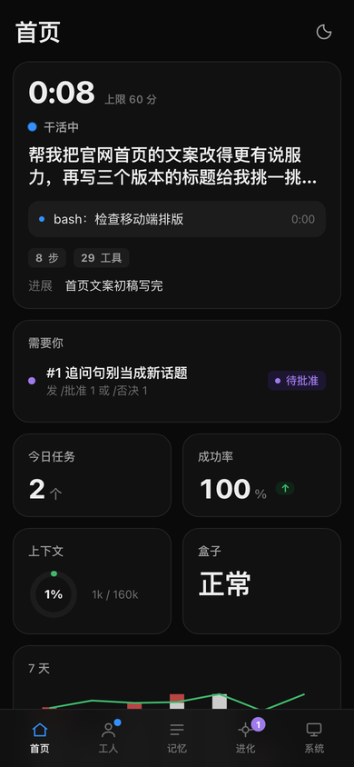
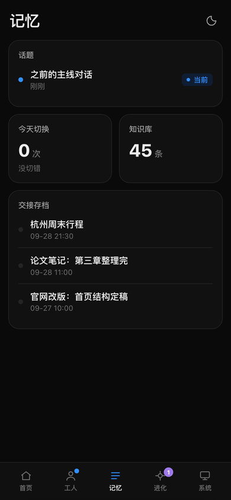
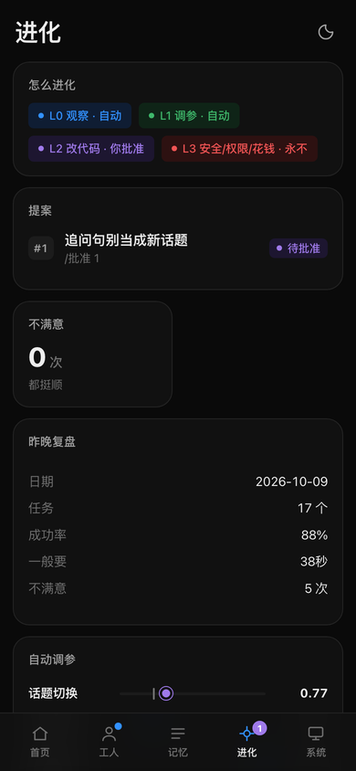
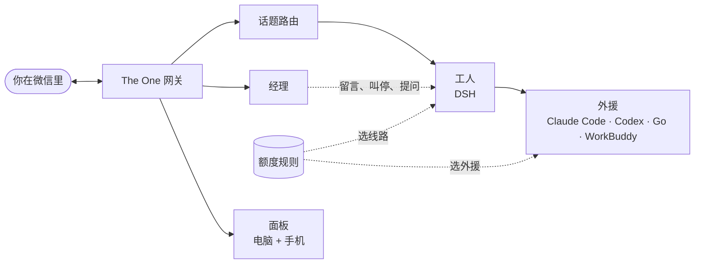

<p align="center">
  
</p>

<h1 align="center">The One</h1>

<p align="center">
  <b>一个聊天框，背后是一整个 AI 团队。</b><br>
  在微信里像跟同事说话一样跟它聊。它会把不同的事分开记、记得每件事做到哪，<br>
  还会把活派给还有额度的那家 AI 订阅。
</p>

<p align="center">
  <a href="https://github.com/YunongDai2005/theone-agent/actions/workflows/test.yml"></a>
  <a href="LICENSE"></a>
  <a href="package.json"></a>
  
</p>

<p align="center">
  <a href="README.md">English</a> · <b>简体中文</b>
  &nbsp;·&nbsp; <a href="https://YunongDai2005.github.io/theone-agent/demo/">交互演示</a>
  &nbsp;·&nbsp; <a href="#一分钟试玩">试玩</a>
  &nbsp;·&nbsp; <a href="docs/DEPLOY.md">部署</a>
</p>

---

## 为什么做它

AI 工具你已经买了好几个，可用起来还是很累：

- **每问一句都得先想清楚：这该去哪个会话问。** The One 自己看出这句话是哪件事，接上那件事的会话和记忆。
- **派完活，AI 一闷头就是二十分钟。** 经理随时回你话、帮你转达补充；你说"停"，它马上停。
- **5 小时、每周、每月的额度，几家来回算。** 活会派给还有余量的那家，快重置的优先用掉。

## 它能做什么

| 能力 | 具体是什么 |
| --- | --- |
| **干活时也能聊** | 工人在忙时，经理替它回你：问进度直接答，补充要求先记下，只有新指令和正在做的事冲突时才打断。 |
| **不用挑会话** | 每句话自动归到对应的话题。聊回昨天的项目，它自己接上当时的上下文。说"切错了"就撤回。 |
| **不会忘事** | 会话快满了、过了一天、或者隔了很久没聊，旧会话会写一份交接，新会话接着做。 |
| **额度花在刀刃上** | Go、ChatGPT、Claude Code、WorkBuddy 共用一套额度规则：留安全余量、扣掉在途任务、快重置的先用，某条线路挂了自动换。 |
| **一眼看全局** | 电脑和手机都能用的面板：工人在干嘛、什么事等你处理、今天的数字、各家额度和重置倒计时。 |
| **自己变好，但听你的** | 每晚复盘前一天：在护栏内微调几个参数；写改进提案，你在微信里批准了才会改代码上线。 |

## 看一眼

<p align="center">
  <a href="https://YunongDai2005.github.io/theone-agent/demo/"></a>
</p>

<p align="center"><a href="https://YunongDai2005.github.io/theone-agent/demo/"><b>打开交互回放 →</b></a><br>
<sub>七条消息在官网、电池调研、Python 小工具三件事之间来回，全程不用切会话。路由和会话代码是真的；消息、模型的判断和工人是测试用的假数据。</sub></p>

<table>
  <tr>
    <td align="center"><br><sub>首页：正在做的事和需要你处理的事</sub></td>
    <td align="center"><br><sub>记忆：话题、交接、知识库</sub></td>
    <td align="center"><br><sub>进化：每晚复盘和改进提案</sub></td>
  </tr>
</table>

## 一分钟试玩

不需要微信账号、API 密钥，也不用 `npm install`，有 Node.js 22 以上就行。

```bash
git clone https://github.com/YunongDai2005/theone-agent.git
cd theone-agent

npm test                        # 70 多个回放场景和单元测试，全用假服务
node test/dev-dashboard.mjs     # 带样例数据的面板 → http://127.0.0.1:8933/
npm run demo:record             # 重新录制回放 → 打开 docs/demo/index.html
```

全部只在本机、临时目录里跑，不会碰任何真实账号。

## 怎么跟它说话

直接说人话就行。下面这些命令用来直接控制：

| 发送 | 会发生什么 |
| --- | --- |
| 随便说点什么 | 归到对应话题，工人开始做 |
| `停` | 马上停下当前任务（打字或语音都行） |
| `/进度` | 工人现在在做什么 |
| `/new` | 开一个新话题，旧的都还在，聊回去会自动接上 |
| `切错了` | 上一句放错了话题：撤回，换到对的话题重新回答 |
| `/话题` | 看所有话题 |
| `/经理` | 经理在不在、有几条留言没读、工人有没有问题在等你 |
| `/回答 编号 内容` · `/通过 编号` · `/拒绝 编号` | 回答工人的提问，或者同意/拒绝它要做的操作 |
| `/进化` | 昨晚的复盘和改进提案 |
| `/批准 N` · `/上线 N` · `/否决 N` | 让外援去实现提案、合并上线，或者丢掉 |
| `/看板 想看什么` | 让工人给面板加一张卡片 |
| `/帮助` | 全部命令 |

## 怎么运作的



网关夹在微信（通过腾讯 iLink 和 OpenClaw 微信插件）和一台 Linux 机器上的 DSH（DeepSeek Harness）命令行工人之间。每个功能都是插件：话题、经理、交接、进度、额度、面板卡片、自我复盘。插件只通过几个固定的挂点接入，所以每个功能都能单独关掉，新功能也能自带面板卡片。详见[架构](docs/ARCHITECTURE.md)和[设计](docs/DESIGN.md)。

## 真正跑起来

需要：一台 Linux 机器、DSH 命令行工人、装好 OpenClaw 微信插件并登录机器人账号、至少一家模型的订阅或 API 密钥。

1. 把 `config.example.json` 复制成 `config.json`，填上插件、账号文件和工人的位置。
2. 让 OpenClaw 微信通道走网关：`http://127.0.0.1:8787`。
3. 运行 `npm start`，打开 `http://127.0.0.1:8788/api/v2/status` 确认正常。
4. 用任意静态服务器提供 `web/index.html`，并把 `/api/v2/*` 转发给网关，面板就出来了。

完整步骤，包括密钥放哪、可选插件、隐私说明，见 **[docs/DEPLOY.md](docs/DEPLOY.md)**。

## 现在的状态

还在实验阶段。目前是一个人做的，每天跑在自己家里的一台服务器上。

- **每个聊天一次只做一件事。** 不同话题有各自的会话，但同一个聊天里任务是排队做的。
- **重启只恢复了一部分。** 重启后会清理工人留下的任务，但排队中的任务只存在内存里。
- **模型会判断错。** 话题归属和经理的决定靠模型；测试验证的是"判断之后怎么处理"，不是模型判得准不准。

接下来要做：专门的会话管理员、重启不丢的任务调度、不相干的话题可以并行。详见[路线图](docs/DESIGN.md#roadmap)。

## 参与

最需要帮忙的方向：**对话路由、会话记忆、打断处理、可靠调度**。

- 发现话题分错了？开个 issue，附一段编造的或打过码的对话、你期望它去哪个话题、实际去了哪。
- 想改代码？先读[架构文档](docs/ARCHITECTURE.md)，能写成插件就写插件，补一个回放场景，跑 `npm test`。

如果你也想要这样一个助手，**点个 Star**，在 [Issues](https://github.com/YunongDai2005/theone-agent/issues) 里告诉我们它该应付哪些对话。

## 协议

[MIT](LICENSE)。用到的框架、插件、命令行工具和模型服务各自遵守自己的协议和条款，本仓库不包含它们的代码、模型权重或凭证。曾用名 *AI Box Gateway*。
